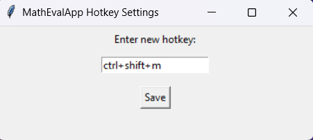

# Word-Math

I built Word-Math as a small Windows tray utility that evaluates arithmetic directly inside Microsoft Word. I can type an expression on a line, end it with `=`, press the configured hotkey, and Word-Math replaces the line with the solved result.



Example:

```text
1250 + 349.99 =
```

becomes:

```text
1250 + 349.99 = 1,599.99
```

## Features

- Works with the active line in Microsoft Word.
- Supports `+`, `-`, `*`, `x`, `/`, decimals, commas, and parentheses.
- Runs from the Windows system tray.
- Lets you change the hotkey from a simple settings window.
- Saves the preferred hotkey in `hotkey.txt`.

## Requirements

- Windows
- Microsoft Word
- Python 3.10+
- Packages listed in `requirements.txt`

## Setup

Install dependencies:

```powershell
python -m pip install -r requirements.txt
```

Run the app:

```powershell
python WordMath.py
```

By default, Word-Math uses:

```text
ctrl+alt+m
```

## Usage

1. Open Microsoft Word.
2. Type a supported math expression on its own line and end it with `=`.
3. Press the configured hotkey.
4. Word-Math replaces the line with the expression and result.

Supported examples:

```text
42 + 18 =
1,250 x 4 =
(100 + 25) / 5 =
-12.5 + 40 =
```

## Notes

Word-Math only evaluates basic arithmetic. I intentionally block Python code execution and unsupported expression types.

The app communicates with Word through the Windows COM interface, so it must run on a Windows machine with Microsoft Word installed.

## Portfolio

Portfolio page: [WordMath Macro](https://wchowellarchive.web.app/Projects/WordMathMacro/WordMath.html)
